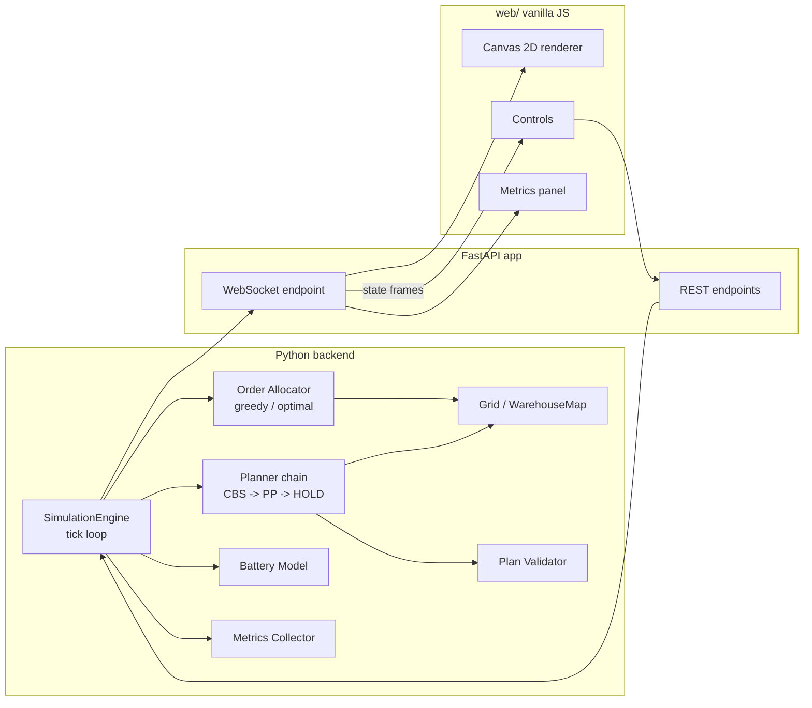

# PLAN.md

## Summary and positioning

`multi-robot-warehouse-planner` is a CPU-only simulation demo of a warehouse automated mobile robot (AMR) fleet. It demonstrates multi-agent path finding (MAPF) with collision avoidance, task allocation, battery management, and deadlock/stall handling on a 2D grid warehouse. It ships a FastAPI + WebSocket backend streaming simulation state to a vanilla JS canvas front end.

This is a planning and simulation demo. It is explicitly not connected to any real robot hardware, fleet manager, or production warehouse system. No GPU, no ML training, no robotics middleware required to run it.

Positioning relative to sibling repos (do not duplicate):
- `robot-fleet-mqtt-telemetry`: telemetry ingestion and visualization only, no planning or simulation.
- `ros2-nav2-slam-sim`: single robot Nav2/SLAM simulation, not multi robot or warehouse task allocation.
- `go-ride-dispatch`: ride matching and dispatch algorithms, not grid based MAPF or physical robot motion.

This repo's unique contribution: multi-robot collision-free path planning (CBS over space-time A*, falling back to prioritized planning) plus order allocation plus battery/charging logic, in one coherent warehouse simulation.

## Scope

In scope:
- Fixed grid warehouse map with shelf access pockets, aisles, charging stations, pick stations, parking pockets.
- 4 to 12 robots, configurable at runtime.
- Order generation and allocation (greedy FCFS baseline, optimal linear assignment via scipy).
- Collision-free MAPF via CBS with space-time A* low-level search.
- Prioritized planning fallback, then HOLD fallback.
- Discrete tick based simulation loop (synchronous, deterministic, seeded).
- Stall/deadlock detection and re-goaling.
- Battery drain and charging model.
- Metrics collection and display.
- Web UI for live visualization and interaction (add orders, block/unblock cells, change robot count, change speed, change allocator, reset).
- Tests: unit, property based (Hypothesis), Playwright smoke test.
- Docker, CI, README, screenshot.

Out of scope: see "Out of scope" section at the end.

## Known limitations

- CBS falls back to prioritized planning (and then HOLD) around 10 to 12 robots on the default map; this is expected and documented, not a bug to "fix" by raising the node cap indefinitely.
- Robots are points on a 1-cell grid: no physical footprint or clearance radius, no acceleration/deceleration, no continuous motion.
- No sensor based obstacle detection; blocking is only user triggered via the UI/API.

## Architecture



Flow: `SimulationEngine.step()` is pure, synchronous and deterministic (seeded). One asyncio task in the FastAPI lifespan calls `await asyncio.to_thread(engine.step)` on a tick timer and then broadcasts state to all connected WebSocket clients. REST handlers only enqueue commands; the engine applies queued commands at the next tick boundary. One uvicorn worker.

## Stack and pinned versions

Runtime (`requirements.txt`):
- Python 3.12
- fastapi==0.161.0
- uvicorn[standard]==0.54.0 (pulls starlette 1.9.0 and websockets 17.3; do not pin websockets directly)
- numpy==2.5.4
- scipy==1.18.1
- pydantic==2.14.1

Dev (`requirements-dev.txt`, `-r requirements.txt` plus):
- pytest==9.1.1
- hypothesis==6.170.5
- playwright==1.64.1
- pytest-playwright==0.10.0
- pytest-timeout==2.4.0
- httpx2==2.16.0 (use httpx2, not httpx: with starlette 1.9 the TestClient still works on httpx but emits a deprecation warning telling you to install httpx2; verified the TestClient works with httpx2 alone)
- ruff==0.17.2

No pytest-asyncio: all tests are synchronous (engine and TestClient are both sync-callable).

Frontend: no build step. Vanilla JS, HTML5 canvas, no npm dependency, no bundler, no CDN dependency.

CI base: `actions/checkout@v7`, `actions/setup-python@v7`, Python 3.12. Docker base image: `python:3.12-slim`. Docker installs `requirements.txt` only (never `requirements-dev.txt`).

## File layout

```
multi-robot-warehouse-planner/
  README.md
  LICENSE
  PLAN.md
  Makefile
  Dockerfile
  requirements.txt
  requirements-dev.txt
  pyproject.toml            # pytest markers config: markers = ["e2e: Playwright browser tests"]
  .gitignore
  .github/
    workflows/
      ci.yml
  app/
    __init__.py
    main.py                 # FastAPI app, lifespan task, routes, WS endpoint
    models.py                # Grid, Robot, Order, CellType, config dataclasses
    grid.py                  # WarehouseMap construction, default map, BFS distance maps
    allocator.py              # greedy FCFS + optimal (linear_sum_assignment) allocation
    planner/
      __init__.py
      astar_st.py              # space-time A*, constraint table
      cbs.py                   # CBS high-level search, conflict detection
      prioritized.py           # prioritized planning fallback
      chain.py                 # plan_joint(): CBS -> PP -> HOLD chain, returns PlanResult
      validate.py               # independent joint-plan / trajectory validator
    battery.py                 # battery drain/charge model
    simulation.py                # SimulationEngine, tick loop, stall/deadlock handling
    metrics.py                   # MetricsCollector
    ws_protocol.py                 # WebSocket/REST message schemas (pydantic)
  web/
    index.html
    app.js
    style.css
  scripts/
    screenshot.py             # Playwright script that drives the UI and writes docs/screenshot.png
  docs/
    screenshot.png
  tests/
    conftest.py
    test_astar_st.py
    test_cbs.py
    test_allocator.py
    test_simulation.py
    test_validate.py
    test_property_planner.py     # Hypothesis: planner correctness
    test_property_simulation.py  # Hypothesis: simulation correctness
    test_api_smoke.py            # Playwright, marked e2e
```

## Core interfaces

```python
# app/models.py
from dataclasses import dataclass, field
from enum import Enum

class CellType(Enum):
    WALL = "wall"
    CORRIDOR = "corridor"
    SHELF_ACCESS = "shelf_access"
    PICK_STATION = "pick_station"
    CHARGER = "charger"
    PARKING = "parking"

Coord = tuple[int, int]  # (row, col)

@dataclass(frozen=True)
class Grid:
    width: int
    height: int
    cell_types: dict[Coord, CellType]

    def is_walkable(self, c: Coord) -> bool: ...
    def neighbors4(self, c: Coord) -> list[Coord]: ...
    def bfs_distances(self, goal: Coord) -> dict[Coord, int]: ...  # cached per goal and grid version
    def reachable(self, start: Coord, blocked: set[Coord]) -> set[Coord]: ...  # BFS reachability

@dataclass
class Robot:
    robot_id: str
    position: Coord
    battery_pct: float          # 0.0 to 100.0
    status: str                 # "idle" | "moving" | "dwelling" | "charging" | "stalled" | "deadlocked" | "blocked"
    current_order_id: str | None
    path: list[Coord] = field(default_factory=list)
    path_start_tick: int = 0
    ticks_without_progress: int = 0
    hold_streak: int = 0
    stall_attempts: int = 0

@dataclass
class Order:
    order_id: str
    shelf_cell: Coord
    created_tick: int
    assigned_robot_id: str | None = None
    picked_tick: int | None = None
    completed_tick: int | None = None

# app/planner/astar_st.py
class ConstraintTable:
    def forbid_vertex(self, agent: str, cell: Coord, k: int) -> None: ...
    def forbid_edge(self, agent: str, u: Coord, v: Coord, k: int) -> None: ...
    def latest_goal_constraint(self, agent: str, goal: Coord) -> int: ...  # -1 if none

def space_time_astar(
    grid: "Grid",
    agent: str,
    start: Coord,
    goal: Coord,
    start_time: int,
    constraints: ConstraintTable,
    horizon: int,
) -> list[Coord] | None:
    """Time-indexed path, index k corresponds to tick start_time + k, path[0] == start.
    Goal is only accepted at k if k > constraints.latest_goal_constraint(agent, goal).
    Closed set is on (cell, k). Returns None if no path found within horizon."""

# app/planner/cbs.py
@dataclass
class Conflict:
    kind: str          # "vertex" | "edge"
    agent_a: str
    agent_b: str
    cell_a: Coord
    cell_b: Coord | None
    k: int

@dataclass
class CBSResult:
    paths: dict[str, list[Coord]] | None   # None unless reason == "solved"
    reason: str                             # "solved" | "node_cap" | "timeout" | "low_level_failed"
    nodes_expanded: int
    conflicts_resolved: int                 # high-level branchings performed
    soc: int | None

Clock = Callable[[], float]                  # monotonic seconds; default time.monotonic

def cbs_plan(
    grid: "Grid",
    blocked: frozenset[Coord],
    agents: dict[str, tuple[Coord, Coord]],   # agent_id -> (start, goal); stationary agents have start == goal
    node_cap: int = 400,
    time_budget_s: float = 0.3,
    clock: Clock = time.monotonic,            # tests inject a fake clock
) -> CBSResult:
    """Conflict-free time-indexed paths, index 0 == current tick. The deadline is
    checked inside the high-level loop and inside every low-level A* call.
    SOC = sum of per-agent arrival offsets."""

# app/planner/prioritized.py
def prioritized_plan(
    grid: "Grid",
    blocked: frozenset[Coord],
    agents: dict[str, tuple[Coord, Coord]],
    priority_order: list[str],
) -> dict[str, list[Coord]] | None:
    """Plans agents one at a time in priority_order, reserving each finished
    agent's full path (including its padded goal tail) as moving/static obstacles
    for later agents. Returns None explicitly if any agent's low-level search fails
    (this is NOT guaranteed to always succeed)."""

# app/planner/chain.py
@dataclass
class PlanResult:
    paths: dict[str, list[Coord]]   # for "hold": previous still-valid plan, or every agent [position]
    planner_used: str               # "cbs" | "pp" | "hold"
    cbs: CBSResult
    planning_ms: float

def plan_joint(grid, blocked, agents, previous: dict[str, list[Coord]] | None,
               seed: int, node_cap: int = 400, time_budget_s: float = 0.3,
               clock: Clock = time.monotonic) -> PlanResult: ...

# app/simulation.py
class SimulationEngine:
    def __init__(self, map_rows: list[str] = DEFAULT_MAP, robot_count: int = 6, seed: int = 1,
                 allocator: str = "greedy", auto_orders: bool = True,
                 robot_starts: list[Coord] | None = None) -> None: ...
    def enqueue(self, command: "Command") -> None: ...   # applied at the next tick boundary
    def step(self) -> dict: ...                          # advance one tick, return the tick frame
    def snapshot(self) -> dict: ...
    def debug_set_goal(self, robot_id: str, cell: Coord) -> None: ...   # tests only
    def debug_set_battery(self, robot_id: str, pct: float) -> None: ... # tests only

# app/planner/validate.py
def validate_joint_plan(
    grid: "Grid",
    paths: dict[str, list[Coord]],
) -> list[str]:
    """Returns list of human-readable violations (empty list == valid). Checks:
    every cell walkable and not a currently-blocked cell, no two agents share a
    cell at the same index, no swap conflicts, at most one cell of movement per
    step, paths start at declared starts."""

def validate_trajectory(
    grid: "Grid",
    positions_by_tick: dict[int, dict[str, Coord]],
    blocked_cells_by_tick: dict[int, set[Coord]],
) -> list[str]:
    """Same checks as validate_joint_plan but against the engine's executed
    per-tick positions, used by simulation property tests."""

# app/allocator.py
def greedy_assign(
    orders: list["Order"], robots: list["Robot"], grid: "Grid",
) -> dict[str, str]:
    """order_id -> robot_id. Considers only the oldest R pending orders where
    R = number of available robots. FCFS: for each order in creation order,
    assign the nearest available, battery-eligible robot (BFS distance)."""

def optimal_assign(
    orders: list["Order"], robots: list["Robot"], grid: "Grid",
) -> dict[str, str]:
    """order_id -> robot_id via scipy.optimize.linear_sum_assignment (modified
    Jonker-Volgenant) on a BFS-distance cost matrix restricted to the oldest R
    pending orders where R = number of available robots. Infeasible (ineligible)
    pairs get cost 10**6 instead of inf, and are dropped from the result if
    assigned anyway."""
```

## WebSocket and REST schema

First message to a new client is always a full snapshot (includes the static map). Subsequent messages are tick frames. One sender task per client, backed by a latest-frame queue of size 1 (drop older frames under backpressure).

Snapshot:

```json
{
  "type": "snapshot",
  "map": {"width": 24, "height": 14, "cells": ["########################", "..."]},
  "tick": 0,
  "robots": [],
  "orders": [],
  "blocked_cells": [],
  "metrics": {}
}
```

Tick frame:

```json
{
  "type": "tick",
  "tick": 142,
  "robots": [
    {"id": "r1", "pos": [3, 5], "battery_pct": 72.5, "status": "moving", "order_id": "o17"}
  ],
  "orders": [
    {"id": "o17", "shelf_cell": [3, 6], "status": "pending" }
  ],
  "blocked_cells": [[4, 4]],
  "planner_used": "cbs",
  "metrics": {
    "throughput_per_min": 3.2,
    "throughput_total": 48,
    "last_makespan": 22,
    "last_soc": 980,
    "cumulative_moves": 5120,
    "conflicts_resolved": 11,
    "planning_time_last_ms": 4.7,
    "planning_time_p95_ms": 9.1,
    "replans": 2,
    "planner_used_counts": {"cbs": 40, "pp": 3, "hold": 1},
    "stalls": 1,
    "deadlocks": 0
  }
}
```

REST:
- `POST /api/orders` `{}` -> creates one order at a random free shelf pocket not already targeted by a pending/active order.
- `POST /api/block-cell` `{"row": int, "col": int, "blocked": bool}` -> rejected (400) if the cell is not a corridor cell, is currently occupied, is any robot's committed next cell, is an endpoint cell, or (on block) would disconnect the map per BFS reachability check.
- `POST /api/robots/count` `{"count": int}` -> 4 to 12 inclusive, else 400.
- `POST /api/control` `{"action": "play" | "pause", "speed": float | null}` -> speed optional, in [0.25, 8] when given, else 400.
- `POST /api/config` `{"allocator": "greedy" | "optimal", "seed": int, "auto_orders": bool}` (all fields optional).
- `POST /api/reset` `{}` -> reinitializes the engine with the current config and seed.
- `GET /healthz` -> `{"status": "ok"}`, used by e2e fixture and Docker CI check.

Tick length = 0.5 s of simulated time. 1x speed = 4 ticks per wall second.

## MAPF model

Moves: 4-connected grid moves plus wait, unit cost, 4-connected only (no diagonals).

Paths are coordinate lists indexed from a shared `plan_start_tick`; path index `k` corresponds to tick `plan_start_tick + k`. Finished agents are conceptually padded with their last cell forever when checking conflicts against other agents' paths (this is just a vertex conflict against the padded path, not a separate rule and not a permanent interval stored in another agent's constraint table).

Conflicts:
- Vertex constraint `(agent, cell, k)`: forbids agent occupying cell at index k.
- Edge constraint `(agent, u, v, k)`: forbids agent moving u to v arriving at index k.
- Swap conflict: when A and B would swap cells, the CBS children are: A forbidden `u->v` at k, and B forbidden `v->u` at k.
- Following (one agent enters the cell another vacates in the same step) is allowed. Rotations of length 3 or more are allowed. Do not add extra rules forbidding these.

Low-level goal test: a path reaching `goal` at index `k` is only a valid terminal state if `k > latest_goal_constraint(agent, goal)` (the latest vertex constraint CBS has placed on that agent's goal cell). Without this fix, scenarios where another agent parks early on the goal cell are unsolvable by CBS within the node cap; with the fix, the search finds a short wait-and-return solution.

Goal uniqueness: duplicate goals between two agents are always unsolvable by CBS (exhausts node cap). The allocator and parking/charging logic must reserve every goal cell (shelf access pocket, pick station, charger, parking pocket) so at most one robot targets any given cell at a time.

SOC (sum of costs): for each agent, the arrival offset is the path index at which it reaches its goal and never leaves (0 if it starts and stays at goal). SOC is the sum of arrival offsets over all agents; idle agents (start == goal) cost 0.

Low-level horizon: `max(latest constraint time of any kind on this agent, 0) + number_of_free_cells_on_grid`. Closed set keyed on `(cell, k)`.

Heuristic and allocation cost: BFS distance maps computed per goal cell and cached per grid version (invalidated when blocked_cells changes); used both as the A* heuristic (admissible, since moves are 4-connected unit cost) and as the cost matrix entries for allocation.

## Planner chain

On every replan, run in order and record which planner produced the committed plan:

1. **CBS**: `node_cap=400`, wall-clock safety stop at 300 ms via an injectable clock (never compared via wall-clock in tests; tests inject a fake clock). If CBS returns a solution, commit it, `planner_used = "cbs"`.
2. **Prioritized planning (PP)**: if CBS fails, run PP with robots in robot-id order, then the reversed robot-id order, then up to 3 seeded shuffles, stopping at the first success. If any ordering succeeds, commit it, `planner_used = "pp"`.
3. **HOLD**: if PP fails for every ordering, keep the previous committed joint plan if it is still valid against the current grid and blocked cells (revalidate via `validate_joint_plan`); otherwise every robot waits this tick (holding in place is always vertex- and swap-conflict free). `planner_used = "hold"`.

Expected behavior on the default map (document honestly in README): CBS solves reliably up to about 8 robots at endpoints; PP is required as a fallback starting around 10 to 12 robots, and HOLD is the backstop when PP also fails (e.g. mid-corridor starts at high robot counts). This is a known limitation, not a defect.

## Task lifecycle

1. Order created (random via `POST /api/orders`, or by the seeded auto generator: when `auto_orders` is true, default true, one order every 4 ticks while pending plus active orders < robot count) targets a free shelf access pocket with no existing pending/active order; enters pending queue.
2. Allocation runs every tick when there are pending orders and available (idle, battery-eligible) robots: `greedy_assign` or `optimal_assign` depending on `/api/config`.
3. A robot's order lifecycle: travel to `shelf_cell` -> dwell 2 ticks -> travel to a free pick station -> dwell 2 ticks -> order complete (`completed_tick` set, robot becomes idle). If no pick station is free when the robot finishes dwelling at the shelf, the robot waits in the shelf pocket (re-polling each tick) rather than returning the order.
4. Idle robots with no order route to a free reserved parking pocket (if not already in one) and wait there.
5. Robot count changes: removing a robot returns its current order to pending exactly once (set `assigned_robot_id = None`, no `completed_tick`) and removes it from the grid; adding a robot spawns it at a free parking pocket.

## Allocation

- `greedy_assign` and `optimal_assign` both restrict consideration to the oldest R pending orders, where R = number of currently available robots, to keep the assignment problem square and avoid starving older orders.
- Robots excluded from consideration if battery insufficient (see Battery model) or already assigned/charging/deadlocked.
- `greedy_assign`: FCFS over orders by `created_tick`, each order takes the nearest eligible unassigned robot by BFS distance.
- `optimal_assign`: builds an R x R (or R x available-robots) BFS-distance cost matrix, infeasible pairs get cost `10**6` instead of `inf` (scipy raises `ValueError` on `inf`), solves with `scipy.optimize.linear_sum_assignment`. Verified never worse than greedy in sum of costs on random instances; call this "optimal linear assignment (scipy linear_sum_assignment)".

## Battery

- Drain: 0.5% per move tick, 0% per wait/dwell tick.
- Charge: 5% per tick while parked on a charger cell.
- A robot becomes charger-eligible (routed to a free charger) if, after completing its current leg, `battery_pct < 30`.
- Allocator excludes a robot from new assignment if `battery_pct < drain * (d(robot, shelf) + d(shelf, station) + d(station, nearest_charger)) + 10` (using BFS distances), ensuring it can complete the order and still reach a charger.
- A charging robot leaves the charger (returns to idle/parking) once `battery_pct >= 90`.
- If `battery_pct` reaches 0 (should not happen given the eligibility check, but handle it): the robot becomes an immobilized obstacle (status `"blocked"`, no movement) and a full replan is triggered for all other agents treating it as a static wall cell.

## Replanning

- Event-driven, full joint replan (via the planner chain) from the current tick for all robots, at most once per tick.
- Stationary robots (already at goal, or no goal) are modeled as agents with `start == goal`, so the planner can move them aside and back if needed.
- Events are batched within a tick; any of the following queues a replan for the next tick: new assignment, a robot reaching a new leg of its order (shelf -> station -> idle), a cell block/unblock, a robot count change, a reset.
- Executor safety check: before applying a tick, build the joint step (current position to next position for every robot from the committed plan) and validate it (walkable, not blocked, no shared cell, no swap). If invalid, every robot waits this tick and a replan is queued. This catches any deviation such as a robot that stops unexpectedly (verified: a follower collides if its leader stalls).
- Before planning, run BFS reachability per agent from its current cell against current blocked cells. Any agent whose goal is unreachable: re-goal it (if it had an order, return the order to pending; route the robot to its nearest reachable free parking pocket instead), then proceed with planning using the updated goals.

## Stalls and deadlocks

There is no circular wait while executing a valid joint plan; a joint plan produced by CBS or PP is conflict-free by construction, and HOLD (waiting in place) is always conflict-free. Stalls originate only from the planner chain failing to make progress, or from external disruption (a robot not moving as planned, which is caught by the executor validation step below).

A robot is "stalled" if either:
- it has an unfinished goal and has not made net positional progress toward it for 15 ticks (ticks spent dwelling or charging do not count toward this), or
- it has been part of a HOLD-committed plan for 15 consecutive ticks.

On stall: re-goal the robot to its nearest reachable free parking pocket (returning any order to pending); if no free parking pocket is reachable, its goal becomes its current cell. Then trigger a replan. This is deterministic (nearest by BFS distance, ties broken by coordinate order), never a random detour. After 3 such stall-recovery attempts for the same robot without resolution, mark it `"deadlocked"` and treat it as a stationary agent (`start == goal == current cell`) going forward; it no longer participates in allocation.

Test fixtures required (custom `map_rows`, `robot_starts`, `auto_orders=False` and `debug_set_goal`; the engine must accept maps with no shelves, chargers or parking): (1) a solvable siding corridor (`["#####", ".....", "##.##"]`, robots at each end swapping) where both robots reach their goals and `stalls == 0`; (2) an impossible pocketless swap corridor (`["....."]`, robots at each end swapping) where CBS and PP both fail, the engine commits HOLD, detects a stall within 15 to 20 ticks, re-goals both robots (no parking exists, so goal becomes current cell), and runs 200 ticks without hanging or any collision. `"deadlocked"` remains a defensive status for repeated failed recoveries.

## Concurrency

- `SimulationEngine.step()` is pure, synchronous, seeded, and deterministic; it must be fully testable by calling it directly with no server running.
- Exactly one engine task is started in the FastAPI `lifespan`, running a loop that awaits a tick-interval sleep, calls `await asyncio.to_thread(engine.step)`, then broadcasts the resulting frame to all connected WebSocket clients.
- REST handlers never mutate engine state directly; they enqueue a command object consumed by the engine at the next tick boundary.
- Each connected WebSocket client has its own sender task and a latest-frame queue of size 1 (newer frames overwrite older ones if the client is slow, never unbounded growth).
- The first message sent to a newly connected client is always a full snapshot (including the static map), after which it receives tick frames.
- Exactly one uvicorn worker process (no multi-worker deployment; shared in-memory engine state would not be safe across workers).

## Edge cases

- Blocking a cell that is a wall/shelf/pocket/station/charger (non-corridor): rejected, 400.
- Blocking a corridor cell currently occupied by a robot: rejected, 400.
- Blocking a corridor cell that is any robot's committed next cell this tick: rejected, 400.
- Blocking a corridor cell that would disconnect the map (checked via BFS reachability over all currently non-blocked corridor cells): rejected, 400.
- Unblocking a cell: always allowed, triggers a replan.
- Two orders can never target the same shelf pocket simultaneously (checked at order creation).
- Robot count change mid-simulation: in [4, 12] only, else 400; removed robots return their order to pending exactly once; added robots spawn only on free parking pockets.
- Robot battery reaching exactly 0%: becomes a static blocking obstacle, triggers replan for all others (see Battery model).
- CBS exhausting its node cap or safety-clock budget: must fall through to PP, then HOLD, never raise or hang.
- A robot whose goal becomes unreachable mid-plan (due to a block): re-goaled to nearest reachable parking before the next planning pass (see Replanning).

## Metrics definitions

- `throughput_per_min`: completed orders per simulated minute, computed over a sliding 120-tick window (120 ticks = 60 simulated seconds at 0.5 s/tick).
- `throughput_total`: cumulative completed order count since last reset.
- `last_makespan`: max arrival offset (see SOC definition) across agents in the most recently committed plan. Never refer to elapsed simulation ticks as "makespan".
- `last_soc`: sum of costs of the most recently committed plan.
- `cumulative_moves`: cumulative count of executed (non-wait) agent moves since last reset.
- `conflicts_resolved`: cumulative count of CBS high-level branchings (child nodes expanded) since last reset.
- `planning_time_last_ms` / `planning_time_p95_ms`: wall-clock time of the last planner-chain invocation, and the p95 over a rolling window of invocations.
- `replans`: cumulative count of full joint replans triggered since last reset.
- `planner_used_counts`: cumulative counts of `{"cbs": n, "pp": n, "hold": n}` committed plans since last reset.
- `stalls`: cumulative count of robots entering `"stalled"` recovery since last reset.
- `deadlocks`: cumulative count of robots reaching `"deadlocked"` status since last reset.

## Test plan

`tests/test_astar_st.py`:
- Path on an empty grid has length equal to Manhattan distance + 1.
- A vertex constraint `(agent, cell, k)` is never present at index k in the returned path.
- An edge constraint `(agent, u, v, k)` is never used to move into v at index k.
- Goal is not accepted at any index k <= `latest_goal_constraint(agent, goal)`; assert the returned path's goal-arrival index exceeds it.
- Beyond horizon with no path available: returns `None`.

`tests/test_cbs.py`:
- Target-conflict instance (grid `["#####", ".....", "##.##"]`, A from (2,2) to (1,2), B from (1,0) to (1,4)): `reason == "solved"`, `nodes_expanded <= 10`, and A's path leaves (1,2) and returns. With a naive goal test this instance exhausts the node cap, so this pins the goal-test fix.
- Two agents with duplicate goals: `reason in {"node_cap", "low_level_failed"}`, paths is None (expected, not a bug; the engine never creates duplicate goals).
- Planner chain coverage on fixed instances: a solvable instance gives `planner_used == "cbs"`; the junction instance (grid `["#####", ".....", "##.##", "##.##"]`, A (1,0) to (1,2), B (3,2) to (1,4)) run with `node_cap=1` gives `"pp"` (the reversed order [B, A] succeeds, verified) and a valid joint plan; the pocketless corridor swap gives `"hold"`. Also assert prioritized_plan with order [A, B] on the junction instance returns None (PP incompleteness, verified).
- A fixed 2-agent crossing scenario: assert the exact SOC value (computed by hand/oracle) matches `cbs_plan`'s result.
- Node heap ordering: construct a scenario producing multiple same-SOC nodes and assert no `TypeError` from comparing node objects directly (heap keyed on `(soc, n_conflicts, counter, node)`).
- Timeout: inject a fake clock that advances 1 s per call; assert `reason == "timeout"` and `nodes_expanded < node_cap`. Never assert on real wall-clock timing.

`tests/test_allocator.py`:
- On a fixed instance, `optimal_assign`'s total cost <= `greedy_assign`'s total cost; include at least one instance where they strictly differ.
- Both allocators only ever consider the oldest R pending orders (assert order beyond the Rth oldest is never assigned when robots < orders).
- `optimal_assign` with an ineligible (cost 10**6) pair never assigns that pair when a cheaper feasible assignment exists.
- Each order assigned to at most one robot, each robot assigned at most one order, per call.

`tests/test_simulation.py`:
- Tick loop advances robots along committed paths; battery decreases by exactly 0.5% per move tick and increases by 5% per charge tick.
- Full order lifecycle (shelf dwell 2 ticks, station dwell 2 ticks, completion) on a fixed scripted scenario, asserting `completed_tick` is set correctly.
- Siding-corridor fixture: two robots pass without ever reaching `"stalled"` status.
- Pocketless swap-corridor fixture: as described in "Stalls and deadlocks": HOLD committed while goals are impossible, `stalls >= 1`, run of 200 ticks completes, `validate_trajectory` reports no violations.
- Removing a robot with an active order returns exactly one order to pending (`assigned_robot_id` reset, no duplicate in queue).
- Robot battery forced to 0%: assert status becomes `"blocked"` and a replan is triggered treating it as a wall cell.

`tests/test_validate.py`:
- `validate_joint_plan` returns no violations for a known-good CBS output.
- `validate_joint_plan` flags an intentionally corrupted plan (manually inserted vertex collision) with a non-empty violation list.
- `validate_trajectory` flags a manually inserted swap conflict in executed positions.

`tests/test_property_planner.py` (Hypothesis, `max_examples=100`, `deadline=None`, `derandomize=True`, `database=None`):
- Generate 2 to 8 robots on the default map, distinct starts chosen from endpoints and corridor cells, distinct endpoint goals not equal to any start. Run the planner chain; if the result is not `HOLD` (i.e. CBS or PP succeeded), assert `validate_joint_plan` returns no violations.
- Separately (not property-based, fixed instances), compare CBS SOC to a brute-force joint-state BFS oracle for 2 to 3 agents on grids no larger than 4x4, asserting exact equality (guards against a collision-safe-but-suboptimal solver passing the property test vacuously).

`tests/test_property_simulation.py` (Hypothesis, `max_examples=30`, `deadline=None`, `derandomize=True`, `database=None`):
- Generate seeds, robot counts (4 to 12), and command sequences (order creation, block/unblock, speed change) applied over 150 ticks. Assert throughout: executed positions never share a cell at the same tick, no two robots swap cells between consecutive ticks, each robot moves at most one cell per tick, no robot is ever on a wall cell or a currently-blocked cell.

`tests/test_api_smoke.py` (Playwright, marked `@pytest.mark.e2e`):
- Fixture starts `uvicorn` in a subprocess on a free port with `SIM_SEED=1` and `SIM_AUTOSTART=0` env vars, polls `GET /healthz` until ready.
- Page exposes `data-testid="tick-counter"`, `window.__lastFrame`, and `window.__cellPx` for test introspection.
- Test: load page, assert canvas renders; click a known free corridor cell, assert it appears in `blocked_cells` (via `window.__lastFrame`); click play, assert the tick counter increases using Playwright's `expect()` auto-wait (no manual sleeps).

All tests run via `pytest`, no network access, no GPU. `pytest -m "not e2e"` for unit/property tests; `pytest -m e2e` for Playwright (requires `playwright install --with-deps chromium` first).

## CI

`.github/workflows/ci.yml`, three jobs, all on `ubuntu-latest`:
1. `lint-and-unit`: checkout (`actions/checkout@v7`), setup Python 3.12 (`actions/setup-python@v7`), `pip install -r requirements-dev.txt`, `ruff check .`, `pytest -m "not e2e"`.
2. `e2e`: checkout, setup Python 3.12, `pip install -r requirements-dev.txt`, `playwright install --with-deps chromium`, `pytest -m e2e`.
3. `docker`: checkout, `docker build -t mrwp .`, `docker run -d -p 8000:8000 mrwp`, `curl --retry 5 --retry-connrefused http://localhost:8000/healthz`.

CI must be green on a fresh clone with no manual setup beyond what the workflow runs.

## Docker

`Dockerfile`: `python:3.12-slim` base, `pip install -r requirements.txt` (never `requirements-dev.txt`), copy `app/` and `web/`, expose port 8000, `CMD ["uvicorn", "app.main:app", "--host", "0.0.0.0", "--port", "8000"]`.

`Makefile` targets: `make install` (installs `requirements-dev.txt`), `make test` (`pytest -m "not e2e"`), `make e2e` (`playwright install --with-deps chromium && pytest -m e2e`), `make run`, `make docker-build`, `make docker-run`, `make screenshot` (runs `scripts/screenshot.py`).

## Default map

24 columns x 14 rows. Legend: `#` wall/shelf, `.` corridor, `a` shelf access pocket (30 total), `P` pick station (4 total), `C` charger (5 total), `H` parking/spawn (12 total). This is a "well-formed" layout (every endpoint is a dead-end pocket with exactly one corridor neighbor, so a robot can always wait clear of through-traffic in its own pocket). Use exactly this map, verbatim:

```
########################
#H#H#H#H#H#H#C#C#C#C#C##
#......................#
#.#a##a##a#..#a##a##a#.#
#.##a##a###..##a##a###.#
#......................#
#.#a##a##a#..#a##a##a#.#
#.##a##a###..##a##a###.#
#......................#
#.#a##a##a#..#a##a##a#.#
#.##a##a###..##a##a###.#
#......................#
#P#P#P#P#H#H#H#H#H#H####
########################
```

Note: corridor cell at row 2, col 3 (0-indexed) is an articulation point whose blocking would isolate two pockets; this is exactly why the block-cell BFS reachability check in "Edge cases" is required, not optional.

## README outline

1. Title, one-line description, screenshot (`docs/screenshot.png`).
2. Bold disclaimer, verbatim in spirit: "This is a simulation demo. It is not connected to real robots, a fleet manager, or any production warehouse system."
3. Features list (grid map, CBS MAPF with PP/HOLD fallback, two allocators, battery model, live UI, metrics).
4. Honest note on known limitations (CBS falls back around 10 to 12 robots; point robots on a grid; no physical clearance) linking to "Known limitations" above.
5. Quickstart: `make install && make run`, open `http://localhost:8000`.
6. Architecture diagram (reuse mermaid from this plan).
7. How it works: short explanation of CBS, space-time A*, and the planner chain fallback order.
8. Running tests: `make test` and `make e2e`.
9. Docker usage: `make docker-build && make docker-run`.
10. Concept note on ROS 2 / Open-RMF naming (optional section): state plainly that no ROS 2 or Open-RMF code is used; only loosely analogous concepts for orientation, e.g. the greedy/optimal allocator resembles Open-RMF's `BidNotice`/`BidProposal` task-dispatch bidding (`rmf_task_msgs`), robot state resembles `rmf_fleet_msgs` `RobotState`/`FleetState`, charging routing resembles `rmf_fleet_msgs` `ChargingAssignment`, and a committed path resembles `rmf_traffic` `Itinerary`/`Route`.
11. License (MIT).

## Success criteria

Every item must be objectively checkable by a builder (coding agent or human):

1. `make install && make run` starts the server; the web UI is reachable at `http://localhost:8000` and renders the grid with shelves, pockets, chargers, and pick stations.
2. Robot count can be changed between 4 and 12 via the UI/API without crashing; a count outside that range is rejected with HTTP 400.
3. Orders can be added via the UI/API and are visibly allocated and completed over time in the metrics panel.
4. Both `greedy_assign` and `optimal_assign` exist and are selectable via `POST /api/config`; a unit test proves `optimal_assign`'s total cost is strictly less than `greedy_assign`'s on at least one instance.
5. CBS, PP, and HOLD are all implemented; unit tests on fixed instances produce each of `planner_used == "cbs"`, `"pp"` and `"hold"`, and the target-conflict instance is solved by CBS in at most 10 nodes.
6. `pytest -m "not e2e"` passes fully, including both Hypothesis property tests at their specified `max_examples`.
7. `pytest -m e2e` passes headless in CI.
8. Clicking an eligible corridor cell in the running UI blocks it and visibly triggers a replan; clicking an ineligible cell (occupied, non-corridor, or disconnecting) is rejected with a visible error.
9. Battery visibly drains during movement in the UI and a robot autonomously routes to and recovers at a charger.
10. The pocketless swap-corridor fixture test passes: HOLD is committed, a stall is detected and recovered, and 200 ticks run without hanging or collisions.
11. The metrics panel displays, at minimum: `throughput_per_min`, `last_makespan`, `last_soc`, `conflicts_resolved`, `planning_time_last_ms`, `replans`, `planner_used_counts`, `stalls`, `deadlocks`.
12. GitHub Actions CI is green (all three jobs) on a fresh clone with no manual setup beyond the workflow steps.
13. `docker build` succeeds and the resulting container serves the same UI on port 8000, verified by `curl /healthz`.
14. `README.md` contains the simulation-only disclaimer and references `docs/screenshot.png`, and that file exists and is a valid, non-empty PNG.
15. No GPU dependency anywhere in `requirements.txt`, `requirements-dev.txt`, or `Dockerfile`.
16. No em dash (U+2014) or en dash (U+2013) appears in any tracked file (docs, code, comments); CI or a test greps for them.
17. The default map in `app/grid.py` matches the verbatim map in this plan exactly (24 columns, 14 rows).

## Out of scope

- Real robot hardware integration, drivers, or network protocols (MQTT, ROS 2 DDS, etc.); no ROS 2 or Open-RMF code dependency of any kind.
- 3D visualization or continuous physics simulation.
- Dynamic sensor-based obstacle detection (blocking is only user-triggered via the UI/API).
- Persistent storage, database, or historical analytics beyond in-memory/session metrics.
- Multi-process or distributed simulation, horizontal scaling, multiple uvicorn workers.
- Authentication, multi-tenant or multi-user session isolation.
- Continuous (non-grid) motion planning, kinematic or dynamic robot models, robot footprint/clearance.
- Any GPU-accelerated or ML-based planning or allocation approach.
- Diagonal moves, variable move costs, or non-uniform tick durations.
