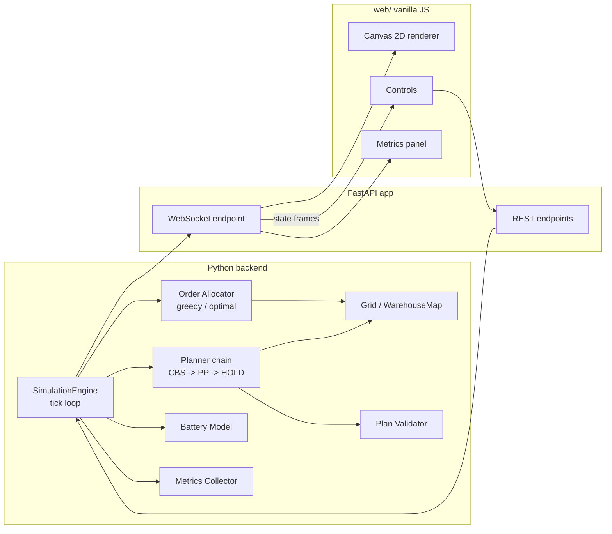

# Multi-Robot Warehouse Planner

[](https://github.com/applycoding/multi-robot-warehouse-planner/actions/workflows/ci.yml)

CPU-only simulation of a warehouse AMR fleet with multi-agent path finding (CBS + prioritized planning fallback), task allocation, battery management, and a live canvas UI.


**This is a simulation demo. It is not connected to real robots, a fleet manager, or any production warehouse system.**

## Features

- Fixed grid warehouse map with shelf pockets, aisles, chargers, pick stations, and parking
- CBS MAPF with space-time A* low-level search, prioritized planning fallback, and HOLD backstop
- Greedy FCFS and optimal linear assignment (`scipy.optimize.linear_sum_assignment`) allocators
- Battery drain, charging, and eligibility checks
- FastAPI REST + WebSocket streaming to a vanilla JS canvas UI
- Metrics panel, cell blocking, robot count and speed controls

## Known limitations

- CBS falls back to prioritized planning (and then HOLD) around 10 to 12 robots on the default map; this is expected, not a defect.
- Robots are single-cell points on a grid (no footprint or clearance).
- Blocking is user-triggered only (no sensor obstacles).

## Quickstart

```sh
make install
make run
```

Open [http://localhost:8000](http://localhost:8000).

## Architecture



## How it works

Each tick, the simulation may allocate pending orders, then runs a full joint replan through the planner chain: CBS (400 node cap, 300 ms budget), prioritized planning with several robot orderings, then HOLD if needed. Space-time A* respects vertex and edge constraints, including the goal-cell constraint fix for target conflicts. The engine executes one step of the committed plan and validates collisions before applying motion.

## Tests

```sh
make test      # unit + property (no browser)
make e2e       # Playwright smoke test
```

## Docker

```sh
make docker-build
make docker-run
```

## Open-RMF concept note (naming only)

This repo does not use ROS 2 or Open-RMF. Conceptual analogies only:

- Allocators resemble Open-RMF `BidNotice` / `BidProposal` task-dispatch bidding (`rmf_task_msgs`)
- Robot state fields resemble `rmf_fleet_msgs` `RobotState` / `FleetState`
- Charging routing resembles `rmf_fleet_msgs` `ChargingAssignment`
- A committed plan resembles `rmf_traffic` `Itinerary` / `Route`

## Deviations from PLAN.md

- CBS and prioritized low-level search cap consecutive wait steps to one tick off-goal (`max_consecutive_wait=1`) so target-conflict CBS matches the reference leave-and-return behavior and siding swaps remain feasible.
- Crossing SOC unit test uses a 3x3 grid with hand-verified optimal SOC `6` under that wait cap (brute-force joint BFS on the same cap is slower to align for detour paths).
- The simulation engine calls the planner chain with a 1.0 s budget (API/tests still use the 0.3 s default) so prioritized planning has time to run after CBS on busy maps.
- Playwright e2e boots a small open grid (`E2E_SIMPLE_MAP`) so blocking a corridor cell is allowed; the default map rejects most aisle clicks as disconnecting.
- While paused, the tick loop applies queued REST commands (play/pause/block) without advancing simulation ticks so the UI can resume.

## License

MIT License. See [LICENSE](LICENSE).
